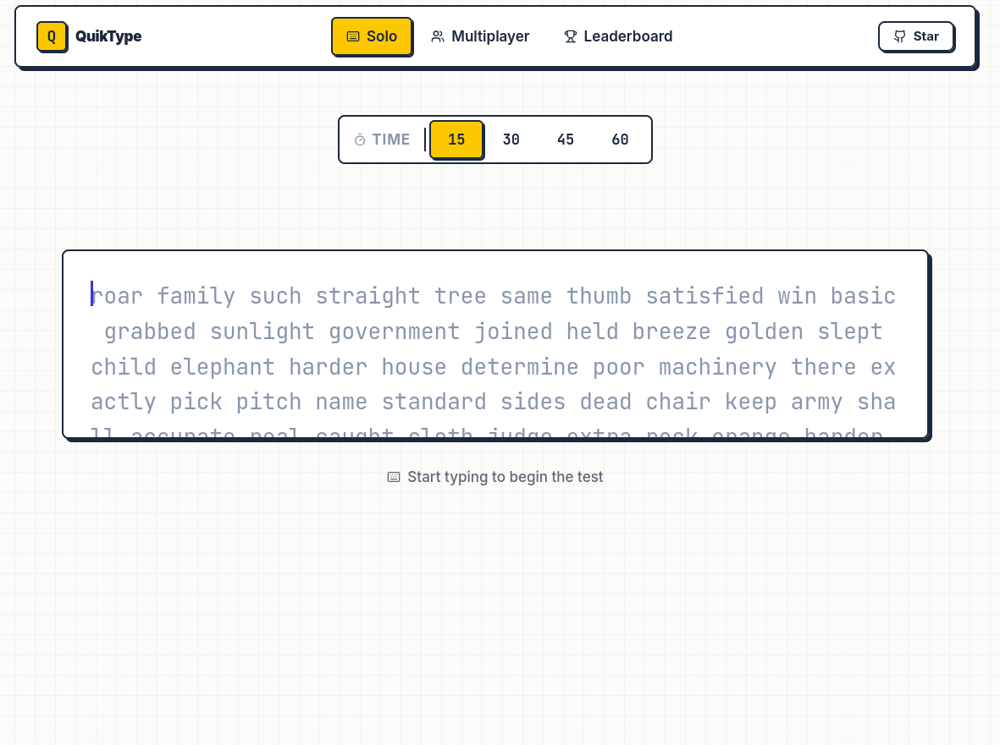

# QuikType

A high-performance, real-time multiplayer typing speed test application built with Next.js and Socket.IO.

Live Application: [quik-type.vercel.app](https://quik-type.vercel.app)

## Screenshot



## Features

### Core Features
- Countdown Timer: A five-second countdown synchronized across players before a test begins.
- Dynamic Test Phase Management: React hooks managing setup, countdown, test, and result phases.
- Real-Time Calculations: Words Per Minute (WPM), raw WPM, accuracy, and character count computed instantly.
- Adaptive Word Generation: Dynamic generation of words with configurable typing duration.

### Multiplayer Capabilities
- Room System: Create or join custom rooms using generated room codes.
- Synchronized Test Start: Coordinated countdown and test launch for all participants.
- Leaderboard Ranking: Post-test WPM and accuracy metrics compiled and ranked.
- Connection Recovery: Socket.IO connection state recovery to handle temporary network issues.

### Event Competition
- Separate participant and admin pages at `/event` and `/event/admin`.
- Admin-created 10- or 15-minute windows with a fixed server-side close time.
- Participants may take repeated 60-second attempts; their best attempt meeting the 80% accuracy floor is ranked by WPM, then accuracy.
- Participants share the same generated prompt for each attempt number, so their rounds are comparable.
- Event attempts and standings persist in SQLite at `EVENT_DATABASE_PATH`.
- Generic OIDC sign-in uses Authorization Code with PKCE and a server-side, HTTP-only session cookie. Configure the admin subject allowlist before opening the event.

## Tech Stack

### Frontend
- Next.js 16
- React 19
- TypeScript
- Tailwind CSS 4
- Lucide React (Icons)
- Socket.IO Client

### Backend
- Express.js
- Socket.IO Server
- CORS integration for secure origin sharing

## Getting Started

### Prerequisites
- Node.js 22.5 or later (the event feature uses the built-in SQLite module)
- npm, yarn, or pnpm

### Installation

1. Clone the repository:
   ```bash
   git clone https://github.com/mystic-06/quik-type.git
   cd quik-type
   ```

2. Install the project dependencies:
   ```bash
   npm install
   ```

3. Configure the environment variables:
   Copy the example for the Next.js frontend and Express backend, then fill in their values:
   ```bash
   cp .env.example .env.local
   cp .env.example .env
   ```
   The backend reads `.env`; Next.js reads `.env.local`. Configure `FRONTEND_URL` and `NEXT_PUBLIC_SOCKET_URL` for the two deployed origins.

### Run in Development

1. Start the Socket.IO Express backend server:
   ```bash
   npm run server:dev
   ```

2. In a separate terminal session, start the Next.js development frontend:
   ```bash
   npm run dev
   ```

3. Access the application in your browser at:
   [http://localhost:3002](http://localhost:3002)

### Run in Production

1. Build the production assets:
   ```bash
   npm run build
   ```

2. Start the production Next.js server:
   ```bash
   npm start
   ```

3. Start the production backend server:
   ```bash
   npm run server
   ```

## Environment Variables

For deployments, set the following environment variables:

- `NEXT_PUBLIC_SOCKET_URL`: URL of the deployed Socket.IO server.
- `PORT`: Server port (defaults to 3001).
- `NODE_ENV`: Set to "production".
- `FRONTEND_URL`: URL of the frontend client (for CORS configuration).
- `OIDC_ISSUER`: OIDC issuer URL; for USAR FOSS OIDC use `https://oidc.fossclub.tech`. Its discovery document is at `/.well-known/openid-configuration`.
- `OIDC_CLIENT_ID`: OIDC client identifier.
- `OIDC_CLIENT_SECRET`: Optional secret for confidential clients; public clients use PKCE without it.
- `OIDC_CLIENT_AUTH_METHOD`: Optional confidential client token endpoint method: `client_secret_basic` (default) or `client_secret_post`.
- `OIDC_REDIRECT_URI`: Registered callback URL, `http://localhost:3001/auth/callback` for local development. Set an exact HTTPS URL in production.
- `OIDC_POST_LOGIN_URL`: Frontend event URL to open after sign-in.
- `OIDC_SCOPES`: Requested scopes (defaults to `openid profile email club` for USAR FOSS OIDC).
- `OIDC_DISPLAY_NAME_CLAIM`: Profile claim shown on the leaderboard (defaults to `name`). The stable OIDC `sub` is the participant key.
- `OIDC_ADMIN_SUBJECTS`: Comma-separated OIDC `sub` values allowed to control the event.
- `OIDC_SESSION_SECRET`: Random server-only secret used to sign the HTTP-only session cookie. Use at least 32 random bytes.
- `OIDC_COOKIE_DOMAIN`: Optional shared parent domain (for example `.example.com`) when the frontend and backend use sibling subdomains.
- `EVENT_DATABASE_PATH`: SQLite file path (defaults to `./data/event.sqlite`). Keep this file on durable storage and back it up for final results.

Generate a local session secret with `node -e "console.log(require('node:crypto').randomBytes(32).toString('base64url'))"`. Register the exact callback URL (`http://localhost:3001/auth/callback` locally, your public API URL plus `/auth/callback` in production) as an app in [USAR FOSS OIDC](https://github.com/USAR-FOSS/OIDC/blob/main/docs/ADDING-AN-APP.md). Use a confidential client with `client_secret_basic`, Authorization Code + PKCE S256, and scopes `openid profile email club`. User identity comes from the verified `sub`; the leaderboard display name uses `name`. Add event admins to `OIDC_ADMIN_SUBJECTS` by their OIDC `sub`. In production, point `EVENT_DATABASE_PATH` at a persistent volume; the backend Docker image exposes `/usr/src/app/data` for this purpose.

The OIDC client must allow the Authorization Code flow with PKCE S256 and the configured scopes. ID tokens signed with RS256 or ES256 are supported. The app reads the configured display-name claim from the verified ID token or the OIDC UserInfo response.

In production, serve the frontend and API from the same site (for example `app.example.com` and `api.example.com`) so browsers accept the HTTP-only session cookie. Set `OIDC_COOKIE_DOMAIN` to the shared parent domain when needed. A frontend and API on unrelated domains may be blocked by third-party cookie restrictions.

The event backend needs Node.js 22.5 or later for `node:sqlite`; update any deployment runtime from Node 20 before enabling the event. Configure OIDC before opening an event. Without it, event APIs reject unauthenticated access. Casual multiplayer remains available without OIDC.

## Project Structure

```
src/
├── app/
│   ├── event/             # Participant event page and admin controls
│   ├── room/[roomId]/     # Dynamic room interfaces
│   ├── multiplayer/       # Multiplayer lobby logic
│   ├── leaderboard/       # Score rankings
│   └── page.tsx           # Application landing page
├── components/
│   ├── CountdownPhase.tsx # Pre-test countdown UI
│   ├── Header.tsx         # Navbar and branding
│   ├── SetupPhase.tsx     # Room configuration UI
│   ├── ResultPhase.tsx    # Post-game statistics and rankings
│   └── TypingArea.tsx     # Core typing game logic
├── hooks/
│   └── useSocket.ts       # Socket.IO event listener hook
└── server/
    ├── auth/              # OIDC login and event session validation
    ├── config/            # CORS and server configurations
    ├── controllers/       # Socket.IO connection event controllers
    ├── jobs/              # Background clean-up scripts
    ├── managers/          # Room and SQLite-backed event state
    ├── routes/            # REST API endpoints
    └── index.js           # Server entry point
```

## License

This project is private and not licensed for public use.
